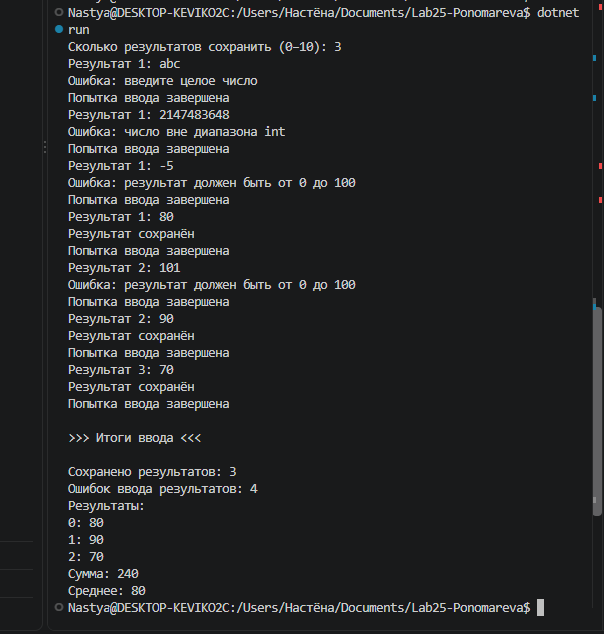

# Практическая работа №25

Автор: Пономарева Анастасия
Группа: ИСП-252

## Тема

Исключения в C#.

## Что реализовано

- ввод количества через TryParse;
- повторный ввод результатов после ошибок;
- обработка FormatException и OverflowException;
- проверка диапазона через throw и ArgumentOutOfRangeException;
- завершение каждой попытки через finally;
- сохранение корректных результатов и вывод статистики.

## Короткие ответы

1. С какой строки продолжается выполнение после обработанного исключения?
Ответ: с первой строки после всей конструкции try/catch. Внутри try с той строки, где возникло исключение, выполнение не возобновляется - оставшиеся
операторы этого блока пропускаются.

2. Для чего нужен finally и почему он не заменяет catch?
Ответ: finally нужен для действий, которые должны выполниться в любом случае. Он не заменяет catch, потому что не обрабатывает исключение: если подходящего catch нет, ошибка всё равно передаётся вызывающему
коду, а finally лишь гарантирует выполнение своих действий.

3. Когда удобнее использовать TryParse вместо Parse с обработкой исключения?
Ответ: когда ожидаемая ошибка - это обычная ситуация, например пользователь
опечатался при вводе числа. TryParse возвращает false и не бросает исключение,
поэтому код повторного ввода получается проще и быстрее. Parse с try/catch
уместен там, где нужно различать причины ошибки или где неудача действительно
исключительна.

## Результат

